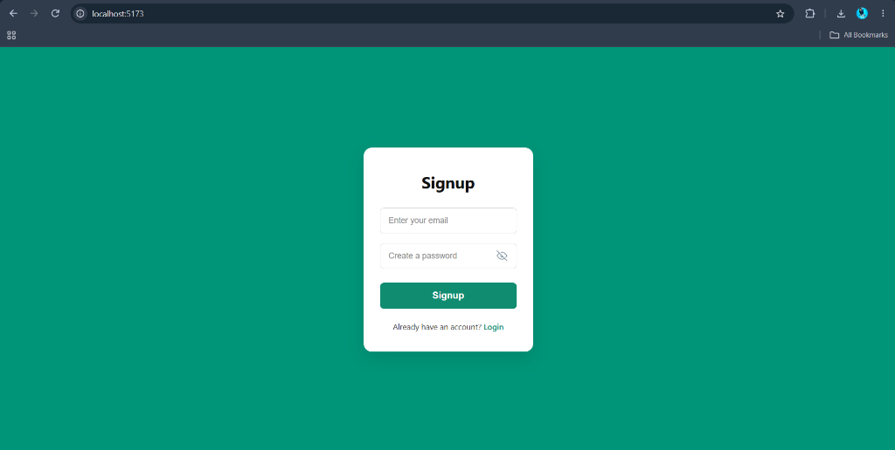
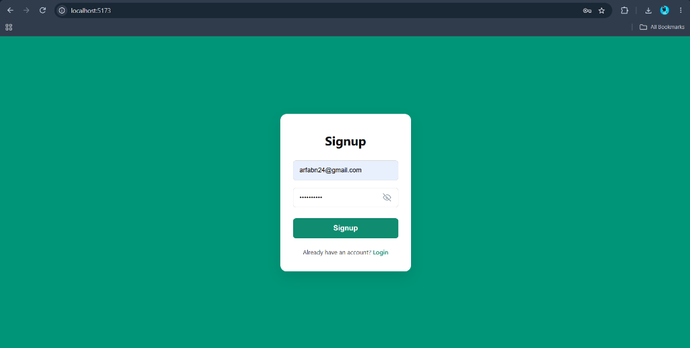
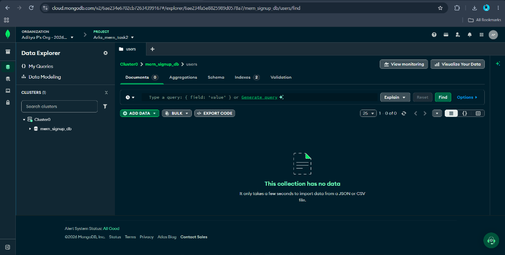
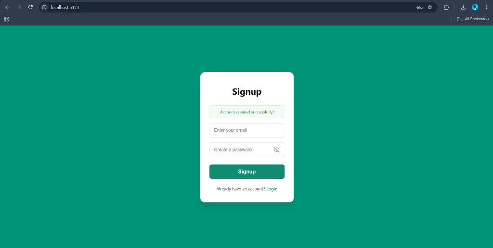
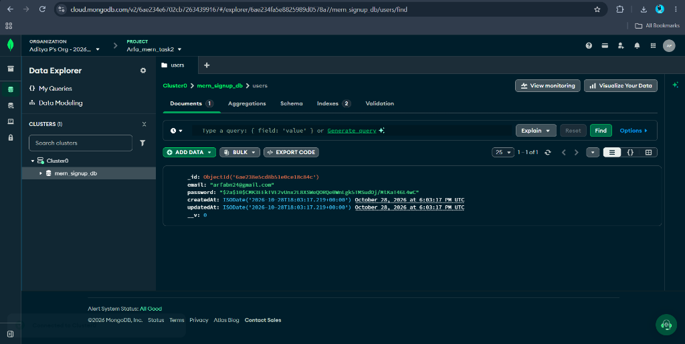

# MERN Stack - Sign Up Feature (Task 2)

A full-stack user registration and authentication system built using the **MERN** stack (MongoDB Atlas, Express.js, React, Node.js) with password hashing via `bcryptjs`.

---

## Output

### 1. Sign Up Page
Initial clean sign-up interface matching the modern rounded-card design.


---

### 2. Inputting User Credentials for Sign Up
User entering their email and password into the registration form.


---

### 3. MongoDB Atlas Collection Before Sign Up
MongoDB Atlas database (`mern_signup_db -> users`) showing that the collection is currently empty before registration.


---

### 4. Output After Pressing Sign Up Button
The React UI displaying the green success notification banner (**"Account created successfully!"**) after the REST API processes the registration.


---

### 5. MongoDB Atlas After Sign Up (Data Stored)
MongoDB Atlas Data Explorer showing the newly created user document stored in the cloud with timestamps and encrypted password hash (`bcrypt`).


---

## Project Structure

```text
mern-task-2/
├── backend/
│   ├── config/
│   │   └── db.js            # MongoDB Atlas connection & DNS resolver
│   ├── controllers/
│   │   └── authController.js# Registration logic (bcrypt hashing, validation)
│   ├── models/
│   │   └── User.js          # Mongoose User schema with email validation
│   ├── routes/
│   │   └── authRoutes.js    # POST /api/auth/signup route
│   ├── .env.example         # Environment template
│   ├── package.json
│   └── server.js            # Express app entry point
├── frontend/
│   ├── src/
│   │   ├── components/
│   │   │   ├── SignUp.jsx   # Sign Up form with React state & API fetch
│   │   │   └── SignUp.css   # Modern rounded card styling & visibility toggle
│   │   ├── App.jsx
│   │   ├── App.css
│   │   └── main.jsx
│   ├── index.html
│   ├── package.json
│   └── vite.config.js
└── screenshots/             # Output proof screenshots
```

---

## Features
- **Frontend**: Responsive React UI built with Vite, featuring password visibility toggle and real-time alert banners.
- **Backend**: Express REST API endpoint (`POST /api/auth/signup`) with input validation and CORS enabled.
- **Security**: Industry-standard password hashing using `bcryptjs` with salt rounds before storing in the database.
- **Database**: Cloud persistence using **MongoDB Atlas**, indexing unique emails to prevent duplicate registrations.

---

## How to Run Locally

### 1. Setup Backend
```bash
cd backend
npm install
# Configure your MongoDB URI in backend/.env
npm run dev
```
Server starts on `http://localhost:5000`.

### 2. Setup Frontend
```bash
cd frontend
npm install
npm run dev
```
Client starts on `http://localhost:5173`.
